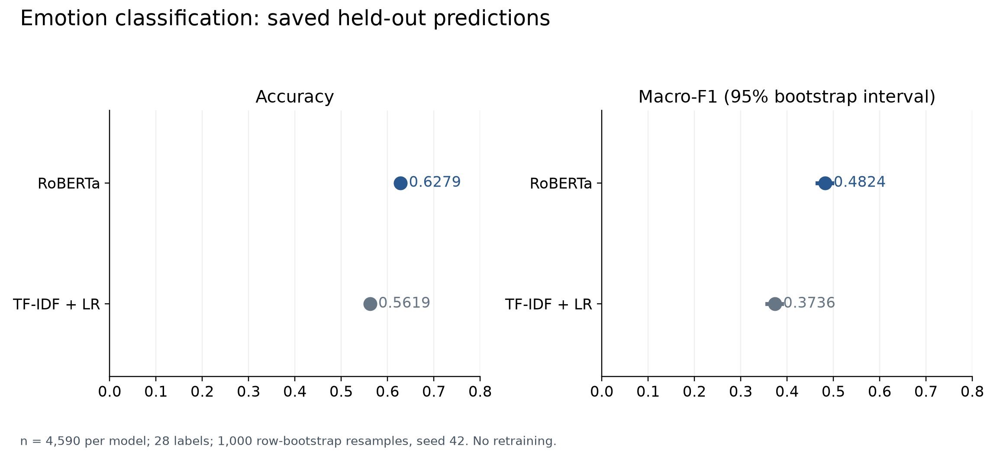
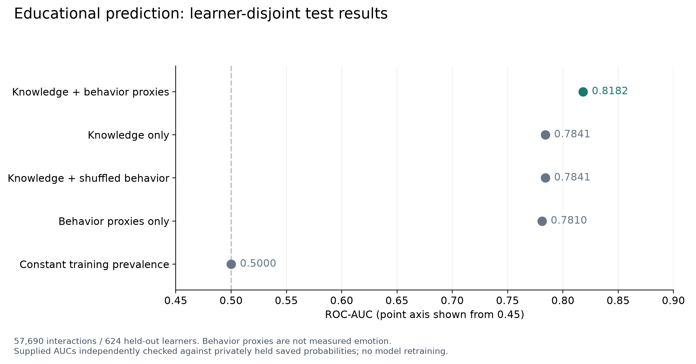
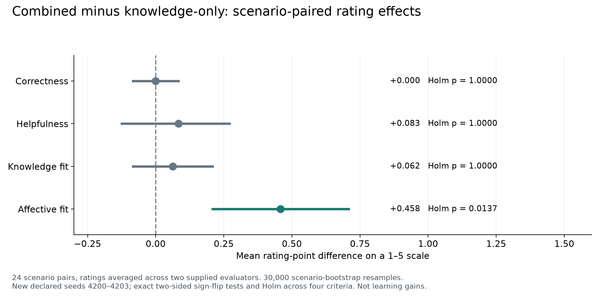

# AKC-Tutor: Objective 3 research repository

This repository accompanies **“AKC-Tutor: An Affect- and Knowledge-Aware Conversational AI Framework for Personalized Intelligent Tutoring”**, by Shiva Nayak Dharavath and Raju Shanmugam. It contains the supplied manuscript, five phase notebooks, saved results, original figures, anonymized response ratings, and an added, independently executable saved-output verification layer.

This is the repository for Objective 3 only. It is not the thesis-wide research home and does not contain implementations of the other thesis objectives.

## Scope and evidence

AKC-Tutor is evaluated as separate components: text emotion classification, educational correctness prediction, deterministic tutoring templates, and response-quality ratings. The emotion and educational datasets are not learner-aligned. The response policy is **not a generative LLM**, and the study does not measure student learning gains.

| Component | Supplied evidence | What the added checks establish |
|---|---|---|
| Phase I: TF-IDF + logistic regression | Notebook, model artifact, 4,590 hard predictions, metrics | Accuracy, macro-F1, confusion matrix and 1,000-resample interval agree with saved outputs |
| Phase II: RoBERTa | Notebook, history, 4,590 predictions and confidence scores | The same saved-output checks; trained RoBERTa weights were not supplied |
| Phase III: educational prediction | Notebook, five-model metrics, four fitted pipelines, split metadata | All five predictive metric sets agree with privately held saved probabilities; new 500-resample learner-cluster sensitivity analysis |
| Phase IV: tutoring policy | 24 authored scenarios, 96 responses, four variants | All 96 response texts, actions and executed bands replay exactly from saved inputs |
| Phase V: ratings | Two workbooks, matching CSVs, 192 response-rating rows | Cell consistency, rating integrity, mean differences, agreement/kappa, new seeded intervals and exact sign-flip tests |

These checks reproduce calculations from saved artifacts; they do not constitute independent retraining, new human evaluation, or authentication of the original data collection.

## Results at a glance

| Experiment | Result | Interpretation |
|---|---:|---|
| TF-IDF + LR accuracy / macro-F1 | 0.561874 / 0.373585 | Single-label GoEmotions subset |
| RoBERTa accuracy / macro-F1 | 0.627887 / 0.482446 | Better held-out classification in the supplied run |
| Knowledge-only ROC-AUC | 0.784085 | Learner-disjoint educational test set |
| Knowledge + behavior-proxy ROC-AUC | 0.818197 | Behavior proxies, not measured emotion |
| Combined minus knowledge-only affective-fit rating | +0.458333 / 5-point scale | Affective-fit outcome is significant after four-outcome adjustment |
| Correctness / helpfulness / knowledge-fit differences | 0.000000 / +0.083333 / +0.062500 | Not statistically significant |

See [results and statistical details](docs/RESULTS.md) for intervals, full ablations and exact-versus-Monte-Carlo distinctions. Helpfulness is the historical preparation metadata's primary endpoint; the affective-fit finding must not silently replace it.





## Reproduce the public checks

Use Python 3.11 or newer in an isolated environment. These commands use public files only and do not download datasets, unpickle models, use a GPU, or call an LLM.

```bash
git clone https://github.com/dharavathshivanayak201-debug/akc-tutor-objective3.git
cd akc-tutor-objective3
python -m venv .venv
# Linux/macOS; on Windows use .venv\Scripts\activate
source .venv/bin/activate
python -m pip install -r requirements.txt
python scripts/verify_integrity.py
python scripts/reproduce.py --output analysis/public-reanalysis.json
python scripts/create_figures.py
python -m unittest discover -s tests -v
```

Phase III prediction-row verification requires an authorized copy of a withheld table; the public command explicitly marks that step “not rerun.” [Reproduction instructions](docs/REPRODUCIBILITY.md) distinguish public verification, private aggregate verification, and complete model retraining.

## Important audit findings

- **Knowledge-band mismatch:** nominal “medium” probability 0.836720 exceeds the implementation's high-band threshold of 0.75. Knowledge-conditioned saved cases execute 13 high and 11 low bands, with no medium-band cases.
- **Distress override:** the original code can change a high-band challenge into a hint for a negative emotion. It does not activate in the saved combined-versus-knowledge-only comparisons; action independence is an observed property here, not a universal property of the implementation.
- **Statistical implementation gap:** the supplied Phase V notebook uses 5,000 bootstrap / 20,000 permutation draws, whereas the paper states 30,000 / 200,000. The exact final historical implementation and RNG sequence are absent; the added analysis uses declared seeds and exact sign-flip inference instead.
- **Data release boundary:** a pseudonymous learner-level educational prediction table is withheld because source row indices permit linkage and redistribution terms remain unresolved. Aggregate verification results and the file hash are included instead.
- **Publication boundary:** this is an auditable research companion, not a certification of journal readiness. See the [limitations and manuscript correction checklist](docs/LIMITATIONS.md).

## Repository guide

```text
akc_tutor/       Portable deterministic policy, transcribed from Phase IV
scripts/         Integrity checks, saved-output reanalysis, companion plotting
tests/           Policy-boundary, metric, response-replay and rating tests
research/        98 unchanged public files from the supplied research package
  code/          Five Colab notebooks and historical support scripts
  paper/         Supplied IEEE PDF, LaTeX, bibliography and vector figures
  results/       Per-phase inherited predictions, metrics and graphs
  evaluation/    Final anonymized rating workbooks and CSVs
analysis/        Aggregate independent reanalysis; no learner-level table
figures/         Five new companion figures in PNG and editable SVG
provenance/      Inherited-file hashes, explicit exclusion, workbook consistency
docs/            Methods, results, data dictionary, reproduction and limitations
```

Start with [the methods/code map](docs/METHODS.md), [data dictionary and provenance](docs/DATA_AND_PROVENANCE.md), and [code-availability wording](docs/CODE_AVAILABILITY.md). Original documents remain unchanged under `research/`; corrections and interpretation are deliberately kept outside that preserved evidence.

## Citation and permissions

Use [CITATION.cff](CITATION.cff) for repository metadata and cite the manuscript according to its eventual publication status. No DOI, acceptance, software license grant, consent statement, or dataset redistribution right has been invented. See [permissions and licensing](LICENSE-NOTICE.md) before reuse.
