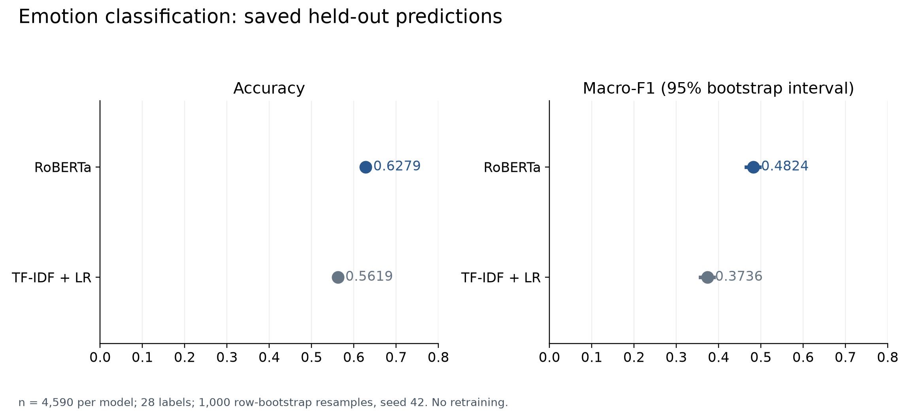
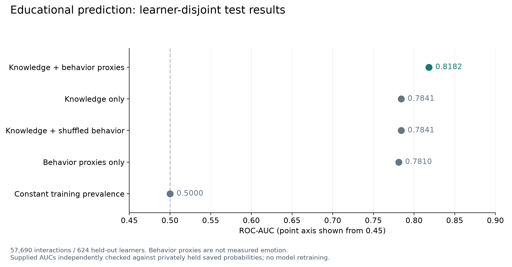
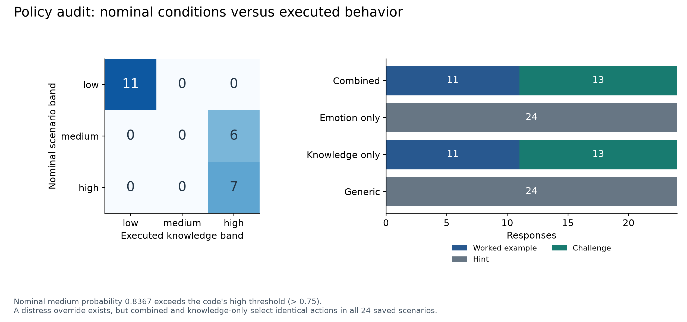
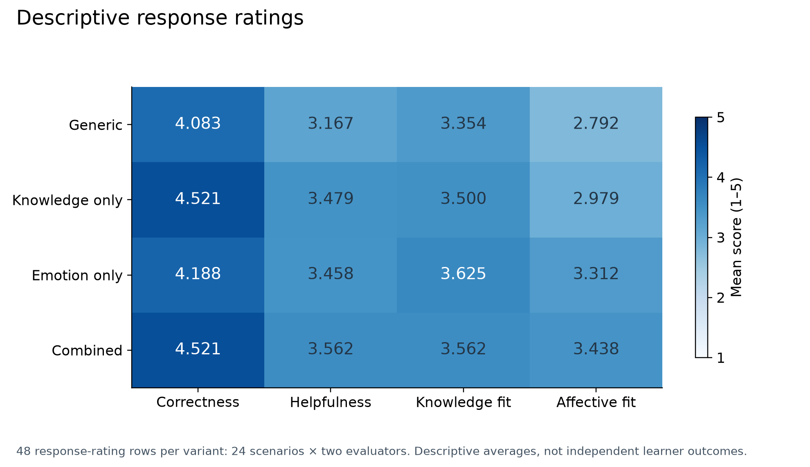
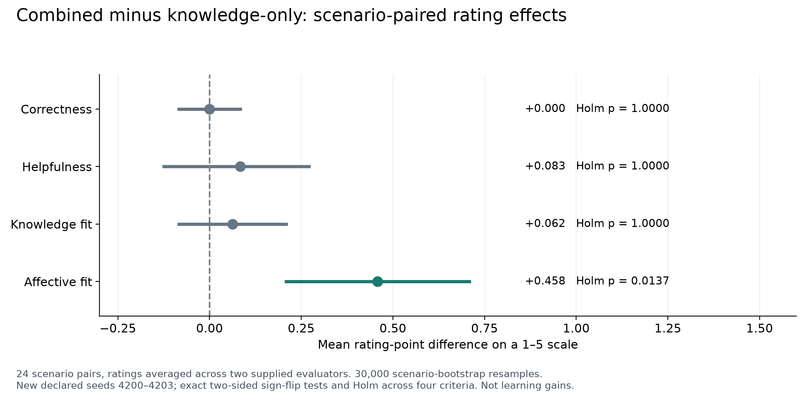

# Results, reanalysis and figure guide

The tables below distinguish supplied historical outputs from newly executed calculations. `analysis/reanalysis.json` records the added aggregate checks; the original inputs remain under `research/`. Numerical agreement establishes saved-output consistency, not independent training provenance.

## Emotion classification

Scores are recomputed from 4,590 saved test predictions per model using all 28 labels. Macro-F1 intervals reproduce the supplied 1,000 row-bootstrap calculations with NumPy seed 42.

| Model | Accuracy | Macro-F1 | Weighted F1 | Macro-F1 95% interval |
|---|---:|---:|---:|---|
| TF-IDF + logistic regression | 0.561874 | 0.373585 | 0.526725 | [0.356654, 0.388435] |
| RoBERTa | 0.627887 | 0.482446 | 0.618329 | [0.465254, 0.496839] |

Both saved confusion matrices match the reconstructed count matrices exactly. This verifies arithmetic from hard predictions; neither model was retrained, and the trained RoBERTa checkpoint is missing. The comparison concerns a single-label subset, not full multilabel GoEmotions or authentic student-affect detection.

## Educational predictive ablations

All five metric sets match the privately retained 57,690-row prediction table, covering 624 test learners. Classification uses a threshold of 0.5; log loss and Brier score are lower-is-better.

| Model | ROC-AUC | Accuracy | F1 | Log loss | Brier |
|---|---:|---:|---:|---:|---:|
| Knowledge + behavior proxies | 0.818197 | 0.794245 | 0.860599 | 0.458799 | 0.147280 |
| Knowledge only | 0.784085 | 0.763651 | 0.841573 | 0.492794 | 0.161836 |
| Knowledge + shuffled behavior | 0.784063 | 0.763616 | 0.841513 | 0.492806 | 0.161843 |
| Behavior proxies only | 0.781034 | 0.782614 | 0.847931 | 0.484821 | 0.155699 |
| Constant training prevalence | 0.500000 | 0.709707 | 0.830209 | 0.602994 | 0.206267 |

Combined-minus-knowledge ROC-AUC is **0.034112**. The supplied 500-replicate learner-cluster interval is [0.027804, 0.041904]; a new 500-replicate cluster rerun with seed 44 and lexicographic pseudonym ordering gives [0.027531, 0.040922]. Both intervals exclude zero, but the rerun is not claimed to recreate the original pre-anonymization sampling sequence.

The constant predictor's relatively high F1 reflects the positive-class prevalence, not discrimination; its ROC-AUC is 0.5. The shuffled-behavior result is close to knowledge-only, while correctly aligned history features improve the supplied run's ranking. Those history features do not measure affect.

The learner-level table is intentionally absent from the public repository, so these Phase III prediction/cluster checks cannot be independently rerun from public files alone. The file hash, aggregate rerun, original model table and release rationale are included.

## Tutoring policy replay

All 96 supplied response texts, actions and executed knowledge bands replay exactly using `akc_tutor/policy.py` with saved probabilities and labels. This uses neither a trained emotion model nor generative inference.

| Nominal condition | Probability | Scenarios | Actual knowledge-conditioned band |
|---|---:|---:|---|
| Low | 0.430699 | 11 | Low |
| Medium | 0.836720 | 6 | High |
| High | 0.910297 | 7 | High |

Thus, knowledge-enabled responses exercise 11 low and 13 high cases, with zero actual medium cases. Generic and emotion-only use the fixed medium/hint branch because knowledge conditioning is disabled.

The code contains a distress-related high-band override, but the saved combined and knowledge-only variants choose identical actions in all 24 scenarios. Their differences in this saved comparison concern wording, not observed action changes. Unit tests exercise the otherwise inactive override using a hypothetical high-probability sadness input.

## Response ratings and paired effects

The final supplied workbooks each contain 96 complete ratings. Every cell agrees with its corresponding CSV at `R1_ratings!A1:I97` and `R2_ratings!A1:I97`; the merged table has 192 response-rating rows, four criteria and 768 scalar scores.

### Descriptive means

Each cell averages 48 response-rating rows: 24 scenarios times two evaluators. These are descriptive response scores on a 1–5 scale, not independent student outcomes.

| Variant | Correctness | Helpfulness | Knowledge fit | Affective fit |
|---|---:|---:|---:|---:|
| Generic | 4.083333 | 3.166667 | 3.354167 | 2.791667 |
| Knowledge only | 4.520833 | 3.479167 | 3.500000 | 2.979167 |
| Emotion only | 4.187500 | 3.458333 | 3.625000 | 3.312500 |
| Combined | 4.520833 | 3.562500 | 3.562500 | 3.437500 |

### Scenario-paired inference

Average the two evaluator scores within scenario/variant, then compute combined minus knowledge-only for each of 24 scenarios. The new intervals use 30,000 bootstrap resamples and seeds 4200–4203; the new p-values use exact two-sided sign-flip distributions with Holm correction across four criteria.

| Criterion | Mean difference | New 95% interval | Exact p | Exact Holm p | Positive / negative / ties |
|---|---:|---|---:|---:|---|
| Correctness | 0.000000 | [-0.083333, 0.083333] | 1.000000 | 1.000000 | 2 / 2 / 20 |
| Helpfulness | 0.083333 | [-0.125000, 0.270833] | 0.549316 | 1.000000 | 8 / 4 / 12 |
| Knowledge fit | 0.062500 | [-0.083333, 0.208333] | 0.593750 | 1.000000 | 5 / 2 / 17 |
| Affective fit | 0.458333 | [0.208333, 0.708333] | 0.003418 | 0.013672 | 11 / 2 / 11 |

Only affective appropriateness is significant after the stated adjustment. Helpfulness was the primary endpoint in historical preparation metadata and is not significant; the significant affective result must not be retrospectively substituted as the original primary outcome.

For affective fit, the supplied historical Monte Carlo p is 0.003399983 and Holm p is 0.013599932. Those differ slightly from exact p 0.003417969 and exact Holm p 0.013671875, as expected for a Monte Carlo versus exact calculation. The final 200,000-permutation script/RNG sequence is not supplied; the new analysis is explicit rather than a claim of exact historical p-value replication.

### Evaluator agreement

The added calculations match the saved exact-agreement and quadratic-weighted kappa values. They use the same 96 response IDs across evaluators; they do not establish evaluator expertise or authenticate independent collection.

| Criterion | Exact agreement | Quadratic-weighted kappa |
|---|---:|---:|
| Correctness | 0.822917 | 0.767786 |
| Helpfulness | 0.447917 | 0.638126 |
| Knowledge fit | 0.500000 | 0.510100 |
| Affective fit | 0.718750 | 0.608696 |

## Figure provenance

All five companion figures are generated by `scripts/create_figures.py` in both PNG and editable SVG. They visualize checked saved outputs or the newly declared reanalysis, not additional experiments. Their captions identify sample sizes, uncertainty methods and interpretation boundaries.

Original per-phase PNGs and four manuscript vector PDFs are preserved separately under `research/results/` and `research/paper/figures/`. The added rating-effect figure uses exact adjusted p-values and new seeded intervals; do not relabel it as the unchanged historical Monte Carlo plot.
